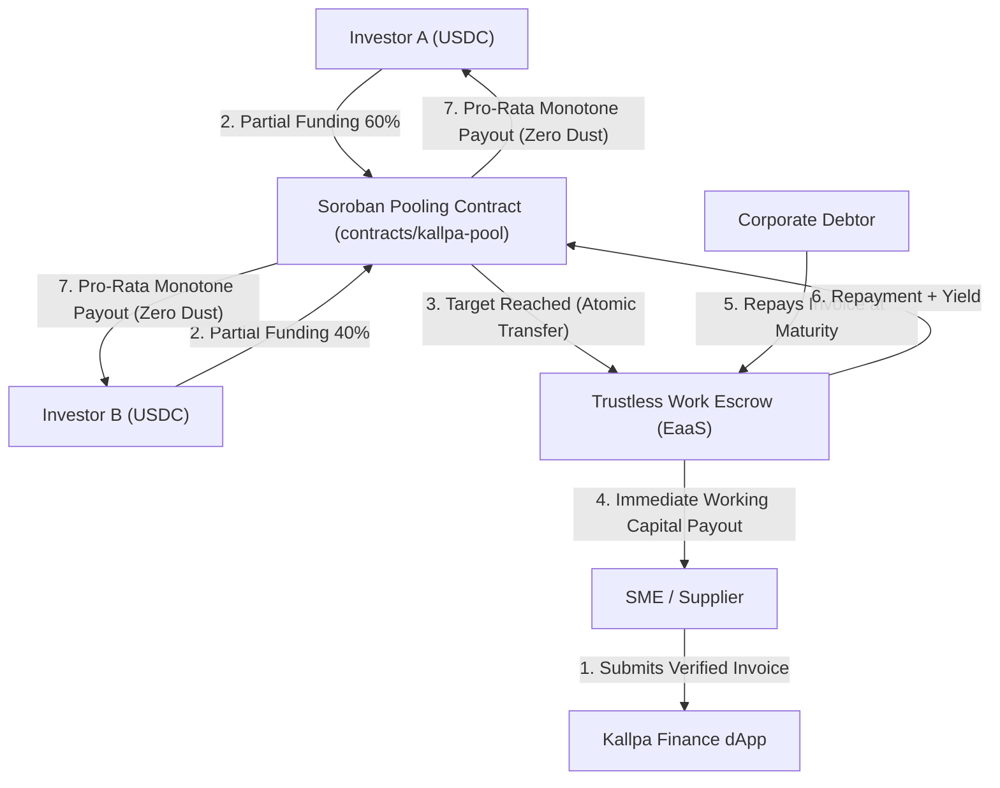

# Kallpa Finance (`kallpa-protocol`)

<p align="center">
  <strong>Decentralized RWA Invoice Factoring & Collective Liquidity on Stellar & Soroban</strong>
  <br />
  <em>Integrated with Trustless Work Escrow-as-a-Service (EaaS)</em>
</p>

<p align="center">
  
  
  
  
</p>

---

## ⚡ Overview

**Kallpa Finance** (*Kallpa* = "Fuerza y Energía Vital" in Quechua) is an open-source, non-custodial **invoice factoring and collective liquidity protocol** designed for small and medium-sized enterprises (SMEs) in emerging markets and Latin America.

Built natively on **Soroban (Rust)** smart contracts and integrated with **Trustless Work**, Kallpa bridges the 60-to-90 day trade credit gap by allowing multiple decentralized investors to co-fund verified commercial invoices with guaranteed, deterministic pro-rata settlement in USDC.

---

## 🏗️ Architecture



### Key Engineering Pillars
1. **Multi-Investor Soroban Pooling (`contracts/kallpa-pool`):**
   - Implements checked arithmetic with strict integer scaling (7 decimals, SEP-41 compliant).
   - Enforces automatic threshold transitions (`Open` → `Funded` → `Settled` or `Refundable`).
   - Persistent storage for investor positions with active TTL lifecycle extension.
2. **Trustless Work Escrow-as-a-Service (EaaS) Integration:**
   - Leverages pre-audited, battle-tested milestone escrow primitives from the *Official SCF Integration List*.
   - Zero ecosystem duplication: capital is atomically transferred to Trustless Work contracts upon pool completion.
3. **Deterministic Pro-Rata Math (`@kallpa/sdk`):**
   - Eliminates rounding drift and cumulative dust errors across multiple concurrent contributors.

---

## 📂 Repository Structure

```
kallpa-protocol/
├── .github/
│   └── workflows/
│       └── ci.yml             # Automated CI for smart contracts and SDK
├── contracts/
│   └── kallpa-pool/           # Core Soroban smart contract in Rust
│       ├── Cargo.toml
│       └── src/
│           ├── lib.rs         # Pool lifecycle, contribution & settlement logic
│           ├── types.rs       # Data structures, errors, and storage keys
│           └── test.rs        # Comprehensive unit & integration tests
├── packages/
│   └── sdk/                   # TypeScript SDK for frontend & agentic integrations
│       ├── package.json
│       └── src/
│           ├── index.ts       # Pro-rata math, capacity validation & helpers
│           └── index.test.ts  # Bun unit tests
├── apps/
│   └── web/                   # Next.js 15 + Tailwind CSS web dashboard (WIP)
├── CONTRIBUTING.md            # Guidelines for open-source contributors
├── LICENSE                    # MIT License
└── README.md
```

---

## 🚀 Getting Started

### Prerequisites
- **Rust Toolchain:** `rustc 1.80+` with target `wasm32-unknown-unknown`
- **Bun:** `v1.1+` (recommended for SDK and frontend) or **Node.js:** `v20+`

### 1. Run Smart Contract Tests
```bash
cargo test --workspace
```

### 2. Run TypeScript SDK Tests
```bash
cd packages/sdk
bun test
```

---

## 🗺️ Roadmap & Milestones (SCF Integration Track)

- [x] **Phase 0:** Core pooling contract architecture and pro-rata math engine.
- [ ] **Milestone 1 ($5,000 USDC):** Soroban contract deployment on Testnet + Trustless Work EaaS adapter.
- [ ] **Milestone 2 ($5,000 USDC):** Off-chain transaction verification service & Next.js investor dashboard.
- [ ] **Milestone 3 ($5,000 USDC):** End-to-end Testnet pilot with multi-investor test flows + Drips Wave maintainer onboarding.

---

## 👤 Maintainer & Lead Builder

- **Carlos Murillo** ([`@camesenin`](https://github.com/camesenin))
  - Core contributor to the **Stellar Wave Program** (Akkuea, Mercato, OFFER-HUB, KindFi, Boundless).
  - Open Source Builder at **Kallpa Labs**.

## 📄 License
This project is licensed under the [MIT License](LICENSE).
