# Kallpa Protocol (`kallpa-protocol`)

<p align="center">
  <strong>Soroban Multi-Party Funding & Zero-Dust Pro-Rata Settlement for Trustless Work Escrows</strong>
  <br />
  <em>Open-Source Infrastructure on Stellar & Soroban</em>
</p>

<p align="center">
  
  
  
  
</p>

---

## ⚡ Overview & Ecosystem Problem

**Kallpa Protocol** is an open-source Soroban smart contract primitive designed to enable **collective multi-party capital aggregation and deterministic zero-dust pro-rata settlement** for **Trustless Work** escrows on the Stellar network.

### The Problem in Trustless Work (Runtime Verification Audit Finding B08)
In the official security audit conducted by **Runtime Verification** on Trustless Work escrows (Page 56, Finding **`B08: Disputed Funds Don't Go Back to Funders`**), a structural limitation was identified: when an escrow dispute or cancellation occurs, refunded funds return solely to the designated `Approver` / single `Depositor`, rather than programmatically flowing back to the individual micro-funders.

Standard Trustless Work Escrow-as-a-Service (EaaS) contracts natively assume a single funding principal (`Depositor` / `Funder` role). **Kallpa bridges this gap** by operating as the non-custodial capital aggregation layer:
1. Multiple decentralized participants pool USDC or SAC tokens towards an escrow milestone target.
2. Once the target is reached, Kallpa deploys and funds the Trustless Work escrow atomically.
3. If an escrow completes, settlement is distributed via **mathematically exact zero-dust pro-rata claims**.
4. If a dispute occurs or the funding deadline expires, refunded funds return to Kallpa, allowing every contributor to claim their exact share permissionlessly on-chain.

---

## 🏗️ Architecture & Operational Modes

```mermaid
flowchart TD
    subgraph Mode A: Public Goods & Collective Bounties
        A1["Participant A (USDC)"] -->|"Partial Contribution"| KP1["Kallpa Pool Contract"]
        A2["Participant B (USDC)"] -->|"Partial Contribution"| KP1
        A3["Participant N (USDC)"] -->|"Partial Contribution"| KP1
        KP1 -->|"Target Reached (Atomic)"| TW1["Trustless Work Escrow (Depositor: Kallpa)"]
        TW1 -->|"Milestone Approved"| DEV["Developer / Auditor (Beneficiary)"]
        TW1 -.->|"Dispute Resolved (SEP-41 Return)"| KP1
        KP1 -.->|"Refund on Dispute (sync_dispute_refund) / Expiry"| A1
    end

    subgraph Mode B: Syndicated Liquidity Advance
        B1["Syndicate Investor 1"] -->|"Advance Liquidity"| KP2["Kallpa Pool Contract"]
        B2["Syndicate Investor 2"] -->|"Advance Liquidity"| KP2
        KP2 -->|"Target Reached (10,000 USDC)"| TW2["Trustless Work Escrow"]
        TW2 -->|"Milestone Delivered"| PROV["Service Provider"]
        DAO["DAO Treasury / External Payer"] -->|"Settlement (11,000 USDC)"| KP2
        KP2 -->|"Individual Pull-Payment (Zero-Dust)"| B1
        KP2 -->|"Individual Pull-Payment (Zero-Dust)"| B2
    end
```



### Key Engineering Pillars
1. **Multi-Party Soroban Pooling (`contracts/kallpa-pool`):**
   - **Checked Integer Arithmetic:** Strictly checked operations (`checked_mul`, `checked_div`, `checked_add`), completely eliminating floating-point rounding drift.
   - **Formal State Machine:** `Open` → `Funded` → `Settled` (with automatic transition to `Refundable` upon expired deadline).
   - **Segregated Storage & TTL Management:** Global pool parameters are stored in `Instance` storage; individual participant balances live in `Persistent` storage with explicit TTL extensions (`env.storage().persistent().extend_ttl()`).
   - **Pull-Payment Pattern (DoS Defense):** To prevent unbounded transaction sizes or exceeding Soroban's CPU/memory execution metering, settlement and refunds are never pushed in loops. Instead, state transitions occur in $O(1)$, and participants pull their entitlement individually via `claim()`.
   - **Collapsed Deposit Slices:** Multiple deposits from the same account collapse into a single position entry, bounding contract footprint and gas requirements.

2. **Trustless Work Interoperability:**
   - Downstream integration with Trustless Work escrow contracts (`github.com/Trustless-Work/trustlesswork-smart-contract-stellar`).
   - Standard Soroban `require_auth()` cross-contract invocation, ensuring funds remain non-custodial and strictly on-chain.

3. **Exact Telescoping Pro-Rata Math (`@kallpa/sdk`):**
   - Algebraic telescoping prefix-sum identity:
     $$\text{Payout}_i = \left\lfloor \frac{C_{\text{after}} \times R}{T} \right\rfloor - \left\lfloor \frac{C_{\text{prior}} \times R}{T} \right\rfloor$$
   - Guarantees that $\sum \text{Payout}_i = R$ identically, leaving zero dust or stranded satoshis in the contract.

---

## 📂 Repository Structure

```
kallpa-protocol/
├── contracts/
│   └── kallpa-pool/           # Core Soroban smart contract in Rust
│       ├── Cargo.toml
│       └── src/
│           ├── lib.rs         # Lifecycle, contribution, pull-claim & settlement logic
│           ├── types.rs       # Data structures, errors, and storage keys
│           └── test.rs        # Comprehensive unit & invariant tests
├── packages/
│   └── sdk/                   # TypeScript SDK for client & integration tooling
│       ├── package.json
│       └── src/
│           ├── index.ts       # Pro-rata math, capacity validation & helpers
│           └── index.test.ts  # Bun unit tests
├── apps/
│   └── web/                   # Next.js 15 reference dApp (WIP)
├── CONTRIBUTING.md            # Guidelines for open-source contributors
├── LICENSE                    # MIT License
└── README.md
```

---

## 🚀 Getting Started

### Prerequisites
- **Rust Toolchain:** `rustc 1.80+` with target `wasm32-unknown-unknown`
- **Bun:** `v1.1+` (recommended for SDK and tests) or **Node.js:** `v20+`

### 1. Run Smart Contract Tests
```bash
cargo test --workspace
```
*Current test suite: 5 passing unit tests (full lifecycle, deadline expiration refund, zero-dust telescoping pro-rata invariant, multiple deposit rejection guard, and escrow dispute refund).*

### 2. Run TypeScript SDK Tests
```bash
cd packages/sdk
bun test
```
*Current test suite: 5 passing unit tests (telescoping pro-rata math, 3-party asymmetric fractional repayments, capacity clamping, negative parsing, and boundary validation).*

---

## 🗺️ Roadmap & Milestones (SCF Build Award v7 — $15,000 USD in XLM)

All development milestones adhere to the **Stellar Community Fund (SCF) Build Award v7 guidelines**, with structured payment tranches tied to verifiable deliverables and a strict 90-day execution window per tranche. External security audits will be requested through the **Stellar Audit Bank**.

| Tranche | % Award | Value (USD) | Verifiable Scope & Deliverables |
| :--- | :---: | :---: | :--- |
| **Tranche #0 (Kickoff)** | 10% | **$1,500** | Completion of onboarding, legal compliance, formal architecture freeze, and technical review session with Trustless Work ecosystem contributors. |
| **Tranche #1 (MVP Core)** | 20% | **$3,000** | Hardened Soroban smart contract in Rust deployed on Testnet. Implementation of the **Pull-Payment claim pattern**, single collapsed deposit positions per user, formal `proptest` property-based fuzzing suite proving the zero-dust invariant across $10^6$ randomized distributions, and automated GitHub Actions CI. |
| **Tranche #2 (Testnet & TW Integration)** | 30% | **$4,500** | Delivery of the `kallpa-adapter-tw` integration crate resolving Runtime Verification finding B08. Automated end-to-end Testnet testing suite simulating full lifecycle: Multi-party pooling → Trustless Work Escrow funding → Milestone release / Dispute trigger → Permissionless pro-rata refund. |
| **Tranche #3 (Mainnet Launch & UX)** | 40% | **$6,000** | Production Mainnet deployment with registered **Onchain Footprint** (Contract IDs, telemetry, and CAP-33 sponsorship configuration). Publication of `@kallpa/sdk` on NPM, responsive reference dApp with Freighter Wallet integration, bilingual documentation, and application to the **Stellar Audit Bank** for external security review. |

---

## 👤 Maintainer & Lead Engineer

- **Carlos Murillo** ([`@camesenin`](https://github.com/camesenin))
  - Active contributor to Soroban and Stellar ecosystem protocols (Tansu DAO governance smart contracts, Boundless Builders infrastructure, Mercato, KindFi).

## 📄 License
This project is licensed under the [MIT License](LICENSE).
