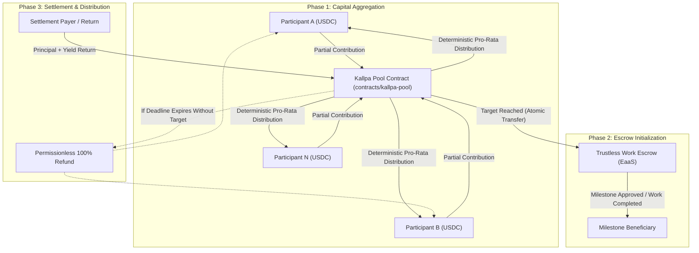

# Kallpa Protocol (`kallpa-protocol`)

<p align="center">
  <strong>Soroban Multi-Party Funding & Pro-Rata Settlement Primitive for Trustless Work Escrows</strong>
  <br />
  <em>Open-Source Infrastructure on Stellar & Soroban</em>
</p>

<p align="center">
  
  
  
</p>

---

## ⚡ Overview

**Kallpa Protocol** is an open-source Soroban smart contract primitive designed to enable **collective multi-party capital aggregation and deterministic pro-rata settlement** for **Trustless Work** escrows on the Stellar network.

While Trustless Work provides battle-tested Escrow-as-a-Service (EaaS) contracts for milestone-based releases, it currently relies on a single-funder pattern. Kallpa bridges this gap by allowing multiple decentralized participants to pool USDC towards a target escrow goal, ensuring atomic milestone transitions, zero rounding drift (*monotone pro-rata integer math*), and permissionless on-chain refunds if funding targets are not met.

---

## 🏗️ Architecture



### Key Engineering Pillars
1. **Multi-Party Soroban Pooling (`contracts/kallpa-pool`):**
   - Strictly checked integer arithmetic (`checked_mul`, `checked_div`, `checked_add`) eliminating floating-point imprecision.
   - Formal state machine: `Open` → `Funded` → `Settled` (or auto-transition to `Refundable` on expired deadline).
   - Segregated storage design: Instance storage for global parameters; persistent storage with explicit TTL extensions (`extend_ttl`) for participant positions.
2. **Trustless Work Interoperability:**
   - Pre-audited milestone escrow primitives downstream.
   - Eliminates custodial aggregation: funds remain on-chain at all times.
3. **Monotone Distribution Math (`@kallpa/sdk`):**
   - Deterministic calculations ensuring total claims exactly equal settled returns without residual dust accumulation.

---

## 📂 Repository Structure

```
kallpa-protocol/
├── contracts/
│   └── kallpa-pool/           # Core Soroban smart contract in Rust
│       ├── Cargo.toml
│       └── src/
│           ├── lib.rs         # Lifecycle, contribution & settlement logic
│           ├── types.rs       # Data structures, errors, and storage keys
│           └── test.rs        # Comprehensive unit & integration tests
├── packages/
│   └── sdk/                   # TypeScript SDK for client & integration tooling
│       ├── package.json
│       └── src/
│           ├── index.ts       # Pro-rata math, capacity validation & helpers
│           └── index.test.ts  # Bun unit tests
├── apps/
│   └── web/                   # Next.js 15 reference dApp (WIP)
├── CONTRIBUTING.md            # Guidelines for open-source contributors
├── LICENSE                    # MIT License
└── README.md
```

---

## 🚀 Getting Started

### Prerequisites
- **Rust Toolchain:** `rustc 1.80+` with target `wasm32-unknown-unknown`
- **Bun:** `v1.1+` (recommended for SDK and tests) or **Node.js:** `v20+`

### 1. Run Smart Contract Tests
```bash
cargo test --workspace
```

### 2. Run TypeScript SDK Tests
```bash
cd packages/sdk
bun test
```

---

## 🗺️ Roadmap & Milestones (SCF Integration Track)

- [x] **Phase 0:** Core pooling contract architecture and pro-rata math engine.
- [ ] **Milestone 1 ($5,000 USDC):** Soroban pooling contract refinement, invariant testing suite, and public Testnet deployment.
- [ ] **Milestone 2 ($5,000 USDC):** Trustless Work integration adapter, milestone event sync, and simulated E2E integration test suite.
- [ ] **Milestone 3 ($5,000 USDC):** Reference Next.js 15 dApp with Freighter Wallet integration, `@kallpa/sdk` NPM publication, and developer integration guide.

---

## 👤 Maintainer & Lead Engineer

- **Carlos Murillo** ([`@camesenin`](https://github.com/camesenin))
  - Active contributor to the **Stellar Wave Program** (Akkuea, Mercato, OFFER-HUB, KindFi, Boundless, Tansu).

## 📄 License
This project is licensed under the [MIT License](LICENSE).
