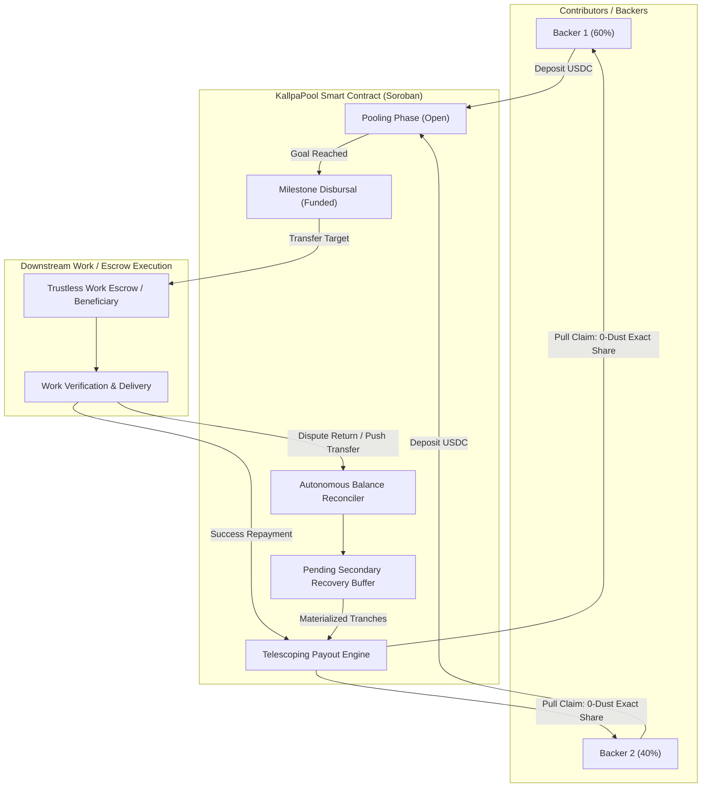
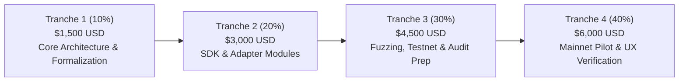

# SCF 7.0 Grant Proposal: Kallpa Protocol

**Project Name:** Kallpa Protocol  
**Track:** Open Track (Build Award – Early Stage Protocol Primitive / Public Infrastructure)  
**Applicant:** Carlos Murillo ([@camesenin](https://github.com/camesenin))  
**Budget Request:** $15,000 USD (disbursed in XLM per official SCF v7 guidelines)  
**Project Repository:** [github.com/camesenin/kallpa-protocol](https://github.com/camesenin/kallpa-protocol) (Open Source: MIT / Apache-2.0)  
**Current Baseline Status:** Phase 0 prototype fully implemented & audited. **53/53 tests passing** (25 Soroban Rust tests + 28 TypeScript SDK/Keeper tests with 96 assertions). Pre-compiled WASM binary: 28,451 bytes (SHA-256: `AD605FA7FD7494F18D4A3423A81350B69548C323FDFA1D57936BC83B4040A0C5`).

---

## 1. Executive Summary

**Kallpa Protocol** is a decentralized, non-custodial capital aggregation and syndication primitive built natively for Soroban on the Stellar network.

While premier escrow infrastructures on Stellar (such as **Trustless Work**) excel at bilateral milestone protection (1 Depositor $\to$ 1 Milestone Beneficiary), many high-impact ecosystem initiatives require **syndicated community funding** where multiple independent backers collectively pool capital for a developer milestone, security audit, public bounty, or decentralized grant.

Kallpa bridges this gap by pooling multi-contributor capital into a dedicated, autonomous Soroban smart contract. When the funding goal is reached, Kallpa deploys or funds the downstream escrow contract. Upon resolution or repayment, Kallpa guarantees **100% exact pro-rata conservation with zero rounding dust** using **discrete telescoping prefix sums**, alongside an autonomous, balance-based reconciliation engine that protects participant funds even in non-cooperative dispute scenarios.

---

## 2. Problem Statement & Ecosystem Need

1. **Bilateral Escrow Friction in Multi-Party Syndicates:** Standard escrow contracts assume a single depositor. When a DAO, syndication pool, or developer group co-funds an initiative (e.g., $10,000 funded by 20 backers), creating 20 parallel bilateral escrows causes massive gas overhead, multiple authorization handshakes, and fragmented dispute resolution.
2. **Rounding Dust & Monotonicity in Soroban Integer Arithmetic:** Standard integer division in multi-tranche or partial repayments truncates fractional stroops, permanently stranding dust balances or creating accounting deficits over time. Kallpa eliminates this by computing discrete entitlements across cumulative prefix sums:
   $$P_{i,k} = \left\lfloor \frac{c_i \cdot S_k}{T} \right\rfloor - \left\lfloor \frac{c_{i-1} \cdot S_k}{T} \right\rfloor$$
   where intermediate prefix terms telescope and cancel out completely:
   $$\sum_{i=1}^N P_{i,k} = \left\lfloor \frac{c_N \cdot S_k}{T} \right\rfloor - \left\lfloor \frac{c_0 \cdot S_k}{T} \right\rfloor = \left\lfloor \frac{T \cdot S_k}{T} \right\rfloor - 0 = S_k$$
   guaranteeing mathematical conservation stroop-for-stroop ($\sum P_{i,k} = S_k$) and non-negative payouts ($P_{i,k} \ge 0$).
3. **Upstream Dispute & Non-Cooperative Recovery:** In standard integrations, if an escrow dispute returns funds via a direct native transfer (push) rather than calling a contract hook, or if an administrator disappears, unallocated balances risk being locked. Kallpa incorporates `reconcile_incoming_balance()`, an invariant-based engine that inspects real SEP-41 token balances and permissionlessly allocates surpluses to backers without privileged keys.

---

## 3. Architecture & Operational Workflows

### Operational Modes:
* **Mode A: Public Goods & Bounty Syndication (Pre-Escrow Buffer):** Contributors pool capital towards a target milestone before deploying or funding the downstream contract. If the funding deadline expires without reaching 100%, backers withdraw immediate, permissionless pull refunds.
* **Mode B: Syndicated Advances & Factoring:** Direct capital aggregation where debt collection or post-default multi-tranche repayments are chunked and streamed into discrete secondary tranches with strictly bounded execution budgets ($\le 10$ tranches per tx).

---

## 4. Milestone Roadmap & Budget Tranches (SCF v7 Standard)

Kallpa follows the official **SCF 7.0 4-tranche disbursement schedule (10% / 20% / 30% / 40%)**:

### Tranche 1 (10% – $1,500 USD): Formal Architecture, Storage Invariants & Security Boundaries
* **Deliverables:**
  * Complete formal specification of discrete prefix-sum telescoping algebra for Soroban.
  * Formalized state machine invariants: dual deadlines (`funding_deadline < repayment_deadline`), permissionless post-deadline triggers, and dust-mitigation gates (`amount >= min_contribution`).
  * Instance & Persistent State Archival lifecycle design compliant with Stellar Protocol 23 (CAP-0066).
* **Acceptance Criteria:**
  * Architecture document published in repo.
  * All unit tests passing with zero compiler warnings under `soroban-sdk v28.0.0`.
  * Public RFC posted on Stellar Developer Discord / GitHub Discussions for community review.

### Tranche 2 (20% – $3,000 USD): Modular Adapter (`kallpa-adapter-tw`) & TypeScript SDK
* **Deliverables:**
  * Official publishing of `@kallpa/sdk` on NPM with complete type definitions (`PoolState.Closed`, etc.).
  * Production `@kallpa/keeper` daemon for relayer operations with Write-Ahead Logging (WAL) and TransactionMetaV4 event ingestion (CAP-0067).
  * Implementation of `kallpa-adapter-tw` establishing cross-contract invocation boundaries and authenticating downstream Trustless Work v2 multi-release escrows.
* **Acceptance Criteria:**
  * NPM package `@kallpa/sdk` live and importable via Bun / Node.js.
  * 100% test coverage across SDK math utilities and Keeper serialization logic.

### Tranche 3 (30% – $4,500 USD): Property-Based Fuzzing, Testnet Deployment & Audit Bank Review
* **Deliverables:**
  * Property-based fuzz testing harness ($10^6$ randomized inputs verifying $\sum P_{i,k} = S_k$ and non-negative monotonicity under extreme edge cases).
  * Live contract deployment on Stellar Testnet with verified code hash.
  * Public developer documentation and integration guides for DAOs (submitting proposal, depositing via Freighter Wallet, and checking pool status).
  * Submission of codebase to the Stellar Audit Bank for formal review.
* **Acceptance Criteria:**
  * Testnet deployment verifiable on Stellar.Expert.
  * Fuzzing reports published showing 0 invariant violations.
  * Formal audit report published with all Medium/High findings remediated.

### Tranche 4 (40% – $6,000 USD): Mainnet Deployment, Web Portal & Live Pilot Syndication
* **Deliverables:**
  * Production deployment of Kallpa smart contracts on Stellar Mainnet.
  * Open-source frontend dApp (Next.js 16 / Tailwind / Freighter integration) allowing non-technical backers to browse active pools, deposit USDC, and claim returns.
  * Execution of at least **one live pilot syndication** with an ecosystem partner or open-source community (e.g., syndicated bounty for an ecosystem tool or audit).
* **Committed On-Chain Metric:**
  * Minimum of **$2,500 USDC** successfully pooled, deposited downstream, and resolved on Mainnet across at least 3 distinct contributor addresses.
* **Acceptance Criteria:**
  * Mainnet contract verified on Stellar.Expert.
  * Public transaction hashes of pilot creation, funding, and final pro-rata claim settlement.
  * Post-launch retrospective and growth roadmap.

---

## 5. Technical Validation & Artifacts

| Component | Status | Details |
| :--- | :---: | :--- |
| **Rust Contract** | **25/25 Green** | `contracts/kallpa-pool/src/test.rs` (Resource limits, zero-dust, multi-tranche) |
| **SDK & Keeper** | **28/28 Green** | `packages/keeper` & `packages/sdk` (96 assertions, TransactionMetaV4 parsing) |
| **Compiled WASM** | **Verified** | `28,451 bytes` (SHA-256: `AD605FA7FD7494F18D4A3423A81350B69548C323FDFA1D57936BC83B4040A0C5`) |
| **Git Baseline** | **Clean & Pushed** | [Commit 9eafe3a](https://github.com/camesenin/kallpa-protocol/commit/9eafe3a) on branch `main` |

---

## 6. Team & Prior Ecosystem Track Record

* **Lead Architect & Engineer:** Carlos Murillo ([@camesenin](https://github.com/camesenin)).
* **Active Stellar / Soroban Contributor:**
  * **`stellar-x402-mcp`:** Creator and maintainer of the first HTTP 402 payment gateway and MCP server on Stellar (105 automated/live tests, fully certified under adversarial audit).
  * **Boundless Builders (`boundlessfi/builders`):** PR #418 (Frontend avatar fault-tolerance).
  * **KindFi (`kindfi-org/kindfi`):** PR #1106 (Project image preview state reconciliation).
  * **Tansu DAO (`Consulting-Manao/tansu`):** PR #261 (Soroban dynamic quorum early-finalization).
  * **Mercato (`mercato-supply-chain/mercato-dapp`):** PR #239 (Inventory preview lifecycle fix).
